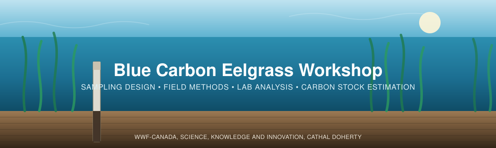
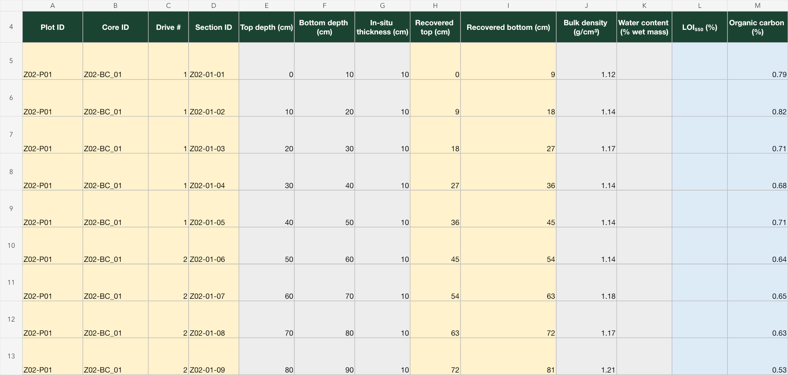
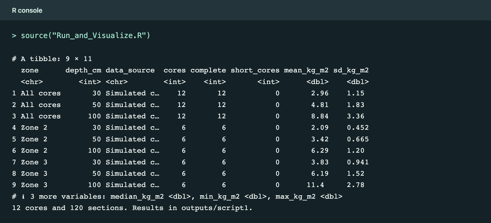
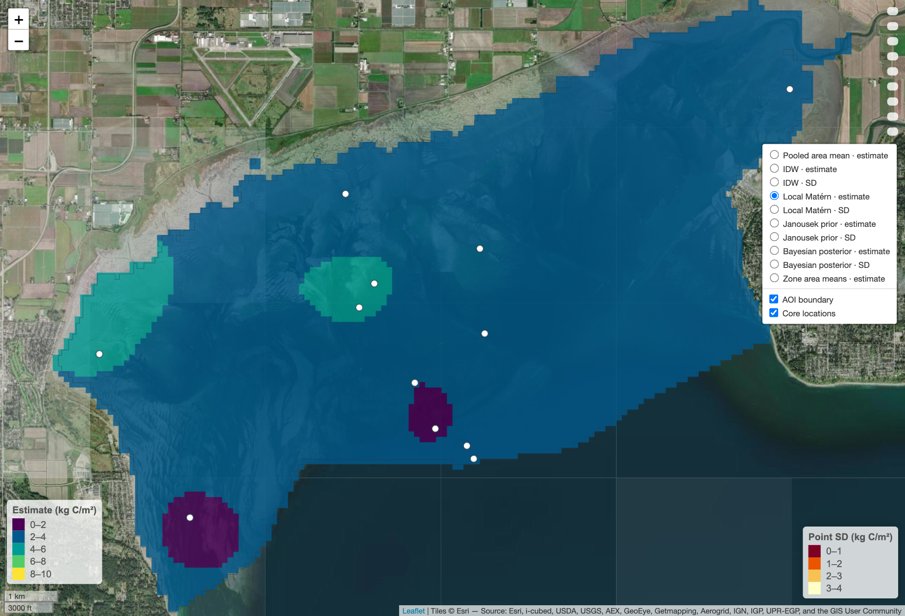
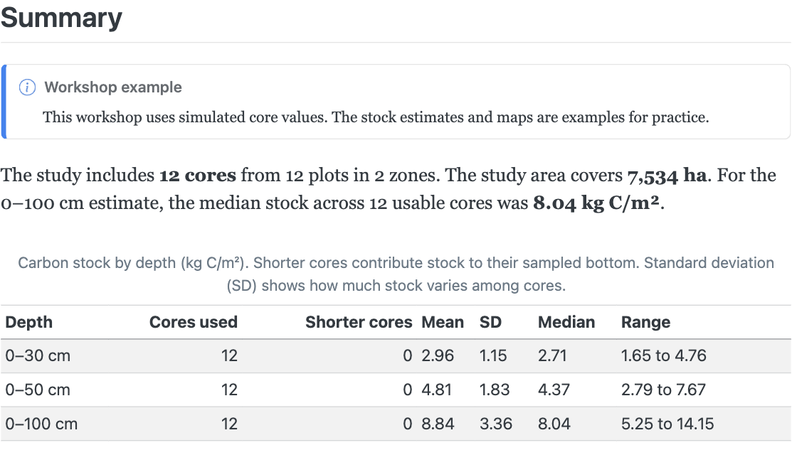
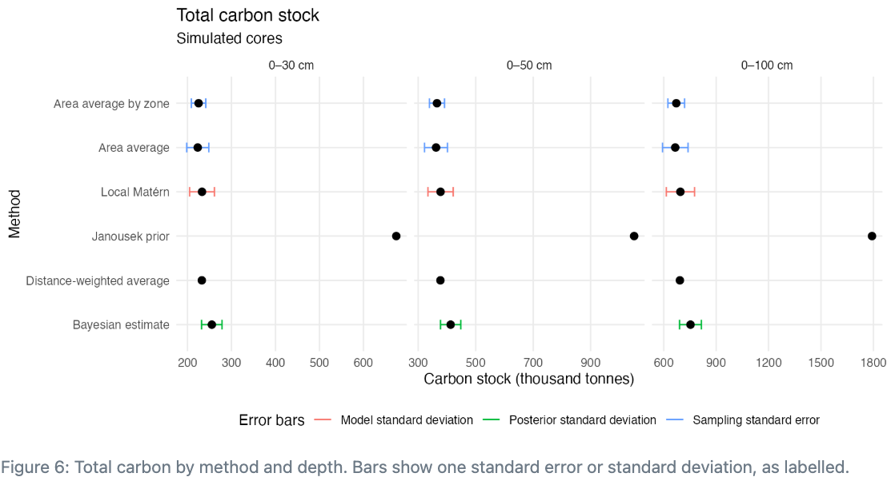

<p align="center">
  
</p>

*From sediment samples to carbon-stock estimates.*

[← 3 — Field Methods](../03_Field_Methods/) · [Back to main guide](../README.md)

---

> The guide covers field-to-lab preparation and includes a separate [Community Analysis, Mapping, and Reporting](#community-analysis-mapping-and-reporting) walkthrough. See [resource availability](../resources.md#pending-materials) for materials still in development.

## Overview

This section covers what happens after the cores come out of the field: prepping your samples,
digitizing your field sheet, sending samples to a lab, checking what comes back, and turning it
into a carbon stock you can report.

It follows WWF-Canada's field guide (*Part 3: Sample Analysis* and *Part 4: Calculating Carbon
Stocks*, pp. 15–19 of the [Coastal Blue Carbon Field Guide](https://wwf.ca/wp-content/uploads/2026/04/Coastal-Blue-Carbon-Field-Guide-FINAL.pdf)),
with a dedicated [Lab Guide](../resources.md#pending-materials) for the laboratory procedures, alongside
Howard et al. (2014).

Everyone follows the same four steps. They take you from bagged samples to checked core stocks
that can be compared with each other. Then the path splits, depending on the question you chose
in [Part 2](../02_Project_Planning/):

| # | Step | Answers |
|---|------|---------|
| 1 | **[From the field to the lab](#step-1--from-the-field-to-the-lab)** | *How do I prep samples, digitize my data, and find a lab?* |
| 2 | **Enter the lab results** *(planned)* | *Where does each number from the lab go?* |
| 3 | **Check the data** *(planned)* | *Is anything missing, mislabelled or inconsistent?* |
| 4 | **Core stocks on a common footing** *(planned)* | *How much carbon is in each core, to which depth?* |
| A | **Option A — our cores, and how they compare** *(planned)* | *What do our samples tell us, and how do they compare?* |
| B | **Option B — an estimate for a defined area** *(planned)* | *What do our measurements imply for this meadow or study area?* |
| 5 | **Report the results** *(planned)* | *What do I report, and what does each number mean?* |

Files: the
> [example digital data sheet](../resources.md#pending-materials), the
> [example lab results sheet](../resources.md#pending-materials) and the
> [community analysis workflow](#community-analysis-mapping-and-reporting).

---

## Step 1 — From the field to the lab

You come back from the field with two things:

1. **A cooler of bagged samples**, which need to be processed and prepped for the lab.
2. **A completed paper field data sheet**, which needs to be digitized.

<p class="resource-note">The field-sheet and sample-bag illustration is being prepared.</p>

*What to notice: every bag label matches a row on the field sheet — Core ID, Sample ID and depths.
This is the **constructed Tsawwassen** field example. The community analysis walkthrough below
starts from its own completed workbook with simulated measurements.*

The rest of this step deals with each in turn, then with getting the samples analysed.

> 🎥 **Watch:** [*Processing cores*](https://www.youtube.com/shorts/wZccCeFPZqY) — a short
> walkthrough of what sample processing looks like.

---

### 1.1 Digitize the data sheet

*Type your field notes into the digital sheet, which calculates the rest for you.*

The paper datasheet records information at two levels, and the digital sheet keeps them on two
separate tabs for that reason: some things are true of the **whole core**, and some are true of a
**single slice**.

The examples in these two tables are the **constructed Tsawwassen** field example (Part 3).

**Recorded once per core** — the *Plot & Core Log* tab:

| Field | What it is | Example |
|---|---|---|
| Plot ID | The plot the core was taken in | `WWF-01` |
| Core ID | Unique identifier: site, plot, sampling location | `WWF-01-A` |
| Date / Time | When the core was taken | 2026-06-16, 10:45 |
| Study area / site | Location | Tsawwassen Beach |
| Latitude / Longitude | Coordinates of the core | 49.033540, −123.131287 |
| Photo series ID | Links the core to its photo record | `WWF-01-A-P` |
| Weather / tidal conditions | Context for the sampling day | Partly cloudy, low tide |
| Corer internal diameter (cm) | Only if this core used a different tube from the one on the Instructions tab — **measure it, don't assume it** | *(blank)* |
| Outside depth (cm) | How far the corer was driven in (penetration) | 65.0 |
| Inside depth (cm) | Length of core actually recovered | 58.0 |
| Stratum (code) | The stratum from your sampling design, if you stratified | `Zone 3` |

**Recorded once per slice** — the *Sample Data* tab:

| Field | What it is | Example |
|---|---|---|
| Core ID | Must match the Core Log exactly | `WWF-01-A` |
| Sample ID | Slice number, counting down from the surface | 1 |
| Top depth (cm) | Top of the slice, measured down the core | 0 |
| Bottom depth (cm) | Bottom of the slice | 5 |
| Notes | Texture, colour, roots, shell, rocks | Dense live root mat, dark brown silty clay |

> 📸 **[SCREENSHOT NEEDED]** — the completed paper field data sheet.
>
> 📸 **[SCREENSHOT NEEDED]** — the same sheet digitized, so readers can see how one transfers
> onto the other.

**The digital data sheet**

**📊 [Blank digital data sheet — availability](../resources.md#pending-materials)**
· filled-in example: [`files/Eelgrass_Carbon_DigitalData_Example.xlsx`](../resources.md#pending-materials)
· works in Excel, LibreOffice and Google Sheets (*File → Import*)

<!-- TODO (Cathal): an online Google Sheets copy used to be linked here; it predated the 2026 revision. Re-upload the blank .xlsx and link it here if you want an online copy. -->

The workbook has four tabs, in the same order as the workflow:

| Tab | What it holds | Do you type in it? |
|---|---|---|
| **1. Instructions** | Legend, colour key, units — and three settings: your **corer's internal diameter** and the **LOI equation** (intercept and slope) | Only the three settings |
| **2. Plot & Core Log** | One row per core — plot/core notes, insertion depths, stratum | Yes |
| **3. Sample Data** | One row per slice, in five bands: field · calculated · lab · calculated · check | Yes |
| **4. Core Summary** | Per-core totals and standard depth increments, calculated automatically | No |

Only the **yellow cells** are for typing. Everything grey is a formula — depth interval, volume,
compaction factor, and, once lab results arrive, bulk density and carbon stock.

> ⚠️ **Core IDs must match across tabs.** The compaction factor and corer diameter are looked up
> from the Core Log by Core ID. If the ID on the *Sample Data* tab doesn't match, those cells stay
> blank rather than silently using another core's geometry.

---

## Community Analysis, Mapping, and Reporting

Follow a worked example from a completed sediment data sheet to carbon-stock
estimates, maps and a Quarto report. The **Boundary Bay** example uses **12 cores
and 120 sediment sections with simulated measurements**. It is a separate
exercise from the field-to-lab example above.

[Open the Community Blue Carbon Analysis and Mapping repository](https://github.com/CathalD/BlueCarbon_Community_Carbon_Analysis_Mapping)
· [Setup and run instructions](https://github.com/CathalD/BlueCarbon_Community_Carbon_Analysis_Mapping#run-the-workshop)

### 1. Check the completed data sheet

Open the [example field workbook](https://github.com/CathalD/BlueCarbon_Community_Carbon_Analysis_Mapping/blob/main/data/field/blue_carbon_field_cores.xlsm)
and find the **3. Sediment Data** tab. Each row represents one section of a core.
Match the plot and core IDs across the workbook. Check that section depths are
in order, the units are correct, and dry bulk density and organic carbon values
are present or flagged for review. Keep measured zeros distinct from missing
values. The example includes core locations and a study boundary so you can
take the same data through to a map.

[](images/community-analysis-data-sheet.png)

### 2. Run the analysis and explore the maps in R

Copy and paste this into the R or RStudio console to download the workshop
scripts, example data and mapping inputs. Confirm the download location when prompted.

```r
if (!requireNamespace("usethis", quietly = TRUE)) {
  install.packages("usethis", repos = "https://cloud.r-project.org")
}
usethis::use_course("CathalD/BlueCarbon_Community_Carbon_Analysis_Mapping")
```

Install Quarto and the R packages listed in the [setup instructions](https://github.com/CathalD/BlueCarbon_Community_Carbon_Analysis_Mapping#run-the-workshop).
Set your R working directory to the extracted folder that contains `Run_and_Visualize.R`.
In RStudio, use **Session → Set Working Directory → Choose Directory**. Then run:

```r
source("Run_and_Visualize.R")
view_plot("cores")
view_map(30)
view_table("totals")
```

The runner calculates carbon stock for each core at the 30, 50 and 100 cm targets.
It sums carbon down to the target or to the sampled bottom, whichever comes first.
Check the core summary and the number of shorter or flagged cores before comparing
results at the same depth. Use `view_plot("cores")` to compare the sampled cores
and `view_map(30)` to explore estimates across the study area. Switch between the
stock and uncertainty layers to see where estimates are more or less precise.

[](images/community-analysis-r.png)

[](images/community-analysis-map.png)

*The 0–30 cm map shows the local Matérn stock estimate for the simulated Boundary Bay example. White dots mark the core locations.*

### 3. Read and report the results

Open `Blue_Carbon_Report.html` in your browser after the run finishes. The
[Quarto report source](https://github.com/CathalD/BlueCarbon_Community_Carbon_Analysis_Mapping/blob/main/Blue_Carbon_Report.qmd)
contains the methods, tables, figures and interactive maps.

Start with **Summary** to check how many cores contributed at each depth. At
the 30 cm target, the example mean across the 12 cores is **2.96 kg C/m²**.
In **Stock across the study boundary**, compare how the estimated total varies
by method. For your own report, state the depth, study boundary and area,
number of usable cores, estimation method and uncertainty. Keep stock per unit
area (kg C/m²) distinct from the estimated total for the study area (Mg C).

[](images/community-analysis-report-summary.png)

[](images/community-analysis-report-totals.png)

*The map and report captures use a 100 m local mapping grid. The downloaded
script defaults to 30 m. It skips study-area model uncertainty when the grid
has more than 10,000 cells, so some error bars shown here may be absent.*

### How the Gaussian process maps work

Each model is fit at a reporting depth. The local model learns from the workshop
cores and their geographic distances. The next two models use the same spatial
idea to update a starting estimate from Janousek et al. (2025).

<details>
<summary>1. Local Matérn model using geographic distance</summary>

The local Gaussian process fits a baseline mean to the log stocks of the
workshop cores. It assumes that deviations from that baseline are more similar
at nearby locations. The Matérn kernel turns distance $d$ in metres into a
correlation. With smoothness $\nu = 0.5$, as selected at 30 cm in the example,
the correlation is $\rho(d) = \exp(-d/\ell)$, where $\ell$ is the distance scale.

One distance matrix compares every core with every other core. The model uses
it to account for spatial dependence among observations. A second matrix compares
each core with each prediction cell and determines how strongly the core can
inform that cell. The fitted nugget adds independent variation to the observed
cores. In the local model, predictions far from cores tend toward the fitted
baseline on the log scale.

[Local mapping code](https://github.com/CathalD/BlueCarbon_Community_Carbon_Analysis_Mapping/blob/main/Script_2_local_mapping.R)

</details>

<details>
<summary>2. Start from the Janousek reference cores</summary>

The Bayesian model uses a single regional prior at each depth. It takes the
mean and standard deviation of complete Janousek profiles from the selected
Pacific Northwest ecosystem. The teaching run uses the salt-marsh reference
group. The script matches those two statistics to a lognormal distribution,
giving a baseline log mean and variance that are initially constant across
the study area.

The transfer model makes that baseline vary across the map. At each local core
and prediction cell, it compares the 64 AlphaEarth embedding values with
the embeddings at the reference cores. Reference cores with higher cosine
similarity get more weight in the prior mean and spread. With normalized
embedding vectors $e(s)$ and $e_j$, the normalized weight for reference core $j$
is proportional to $\exp(e(s)^\top e_j / h)$, where $h$ is the bandwidth.
This kernel measures similarity in satellite features. The Matérn kernel still
uses geographic distance to carry the local correction across the map.

[Janousek reference dataset](https://doi.org/10.25573/SERC.28127486)
· [Regional prior code](https://github.com/CathalD/BlueCarbon_Community_Carbon_Analysis_Mapping/blob/main/Script_2.2_Bayesian.R)
· [Transfer model code](https://github.com/CathalD/BlueCarbon_Community_Carbon_Analysis_Mapping/blob/main/Script_3_covariate_transfer.R)

</details>

<details>
<summary>3. Use the distance matrices to carry local residuals into the map</summary>

At local core $i$, the residual is the observed log stock minus the prior log
mean at that location, $r_i = \log(C_i) - m_0(s_i)$. A positive residual means the
core held more carbon than the prior predicted on the log scale. The update
uses those residuals together:

$$
m_{\mathrm{updated}}(s_g) = m_0(s_g) + k_g^\top (K + \tau^2 I)^{-1} r
$$

- $K$ is the core-to-core covariance matrix. Each entry is the Matérn
  correlation at the distance between the cores, multiplied by their prior
  log standard deviations. The diagonal term $\tau^2 I$ adds observation
  variance.
- $k_g$ is the core-to-cell covariance vector for the prediction cell $s_g$.
  Each entry uses the corresponding core-to-cell distance and the two prior
  log standard deviations.

Solving the system accounts for the fact that nearby cores may carry
overlapping information. The correction fades toward zero where the
core-to-cell covariance is small, so the estimate returns toward the prior.
The same covariance calculation reduces the prior variance at cells informed
by the cores. The script converts the updated log mean and variance back to
stock in kg C/m².

Try `view_map(30, "transfer")` and switch between **Janousek prior**,
**Local Matérn correction** and **Updated estimate**. The correction layer
shows the difference between the updated and prior stock estimates in kg C/m².

</details>
