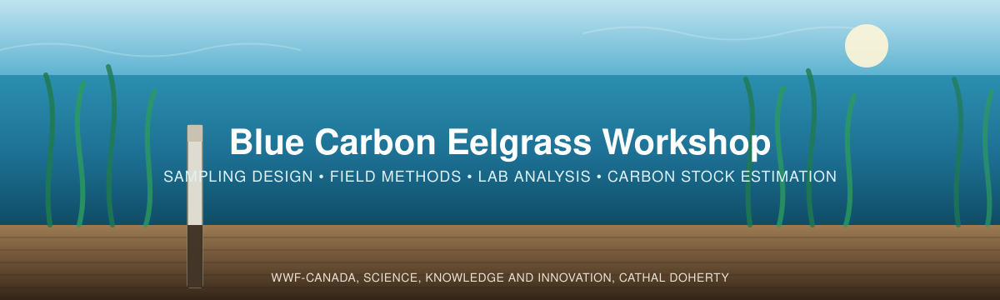

  

*From sediment samples to carbon-stock estimates.*

[← 3 — Field Methods](../03_Field_Methods/) · [Back to main guide](../README.md)

---

> **Component in progress.** The available guide currently covers the overview and field-to-lab preparation. Later analysis sections and the digital downloads are still being prepared. See [resource availability](../resources.md#pending-materials).

## Overview

This section covers what happens after the cores come out of the field: prepping your samples,
digitizing your field sheet, sending samples to a lab, checking what comes back, and turning it
into a carbon stock you can report.

It follows WWF-Canada's field guide (*Part 3: Sample Analysis* and *Part 4: Calculating Carbon
Stocks*, pp. 15–19 of the [Coastal Blue Carbon Field Guide](https://wwf.ca/wp-content/uploads/2026/04/Coastal-Blue-Carbon-Field-Guide-FINAL.pdf)),
with a dedicated [Lab Guide](../resources.md#pending-materials) for the laboratory procedures, alongside
Howard et al. (2014).

Everyone follows the same four steps. They take you from bagged samples to checked core stocks
that can be compared with each other. Then the path splits, depending on the question you chose
in [Part 2](../02_Project_Planning/):

| # | Step | Answers |
|---|------|---------|
| 1 | **[From the field to the lab](#step-1--from-the-field-to-the-lab)** | *How do I prep samples, digitize my data, and find a lab?* |
| 2 | **Enter the lab results** *(planned)* | *Where does each number from the lab go?* |
| 3 | **Check the data** *(planned)* | *Is anything missing, mislabelled or inconsistent?* |
| 4 | **Core stocks on a common footing** *(planned)* | *How much carbon is in each core, to which depth?* |
| A | **Option A — our cores, and how they compare** *(planned)* | *What do our samples tell us, and how do they compare?* |
| B | **Option B — an estimate for a defined area** *(planned)* | *What do our measurements imply for this meadow or study area?* |
| 5 | **Report the results** *(planned)* | *What do I report, and what does each number mean?* |

Files: the
> [example digital data sheet](../resources.md#pending-materials), the
> [example lab results sheet](../resources.md#pending-materials) and the
> [analysis workflow](../resources.md#pending-materials).

---

## Step 1 — From the field to the lab

You come back from the field with two things:

1. **A cooler of bagged samples**, which need to be processed and prepped for the lab.
2. **A completed paper field data sheet**, which needs to be digitized.

The field-sheet and sample-bag illustration is being prepared.

*What to notice: every bag label matches a row on the field sheet — Core ID, Sample ID and depths.
This is the **constructed Tsawwassen** field example; from Step 2 onwards the analysis uses the
published Cowichan cores, which have no paper sheet of their own.*

The rest of this step deals with each in turn, then with getting the samples analysed.

> 🎥 **Watch:** [*Processing cores*](https://www.youtube.com/shorts/wZccCeFPZqY) — a short
> walkthrough of what sample processing looks like.

---

### 1.1 Digitize the data sheet

*Type your field notes into the digital sheet, which calculates the rest for you.*

The paper datasheet records information at two levels, and the digital sheet keeps them on two
separate tabs for that reason: some things are true of the **whole core**, and some are true of a
**single slice**.

The examples in these two tables are the **constructed Tsawwassen** field example (Part 3).

**Recorded once per core** — the *Plot & Core Log* tab:

| Field | What it is | Example |
|---|---|---|
| Plot ID | The plot the core was taken in | `WWF-01` |
| Core ID | Unique identifier: site, plot, sampling location | `WWF-01-A` |
| Date / Time | When the core was taken | 2026-06-16, 10:45 |
| Study area / site | Location | Tsawwassen Beach |
| Latitude / Longitude | Coordinates of the core | 49.033540, −123.131287 |
| Photo series ID | Links the core to its photo record | `WWF-01-A-P` |
| Weather / tidal conditions | Context for the sampling day | Partly cloudy, low tide |
| Corer internal diameter (cm) | Only if this core used a different tube from the one on the Instructions tab — **measure it, don't assume it** | *(blank)* |
| Outside depth (cm) | How far the corer was driven in (penetration) | 65.0 |
| Inside depth (cm) | Length of core actually recovered | 58.0 |
| Stratum (code) | The stratum from your sampling design, if you stratified | `Zone 3` |

**Recorded once per slice** — the *Sample Data* tab:

| Field | What it is | Example |
|---|---|---|
| Core ID | Must match the Core Log exactly | `WWF-01-A` |
| Sample ID | Slice number, counting down from the surface | 1 |
| Top depth (cm) | Top of the slice, measured down the core | 0 |
| Bottom depth (cm) | Bottom of the slice | 5 |
| Notes | Texture, colour, roots, shell, rocks | Dense live root mat, dark brown silty clay |

> 📸 **[SCREENSHOT NEEDED]** — the completed paper field data sheet.
>
> 📸 **[SCREENSHOT NEEDED]** — the same sheet digitized, so readers can see how one transfers
> onto the other.

**The digital data sheet**

**📊 [Blank digital data sheet — availability](../resources.md#pending-materials)**
· filled-in example: [`files/Eelgrass_Carbon_DigitalData_Example.xlsx`](../resources.md#pending-materials)
· works in Excel, LibreOffice and Google Sheets (*File → Import*)

<!-- TODO (Cathal): an online Google Sheets copy used to be linked here; it predated the 2026 revision. Re-upload the blank .xlsx and link it here if you want an online copy. -->

The workbook has four tabs, in the same order as the workflow:

| Tab | What it holds | Do you type in it? |
|---|---|---|
| **1. Instructions** | Legend, colour key, units — and three settings: your **corer's internal diameter** and the **LOI equation** (intercept and slope) | Only the three settings |
| **2. Plot & Core Log** | One row per core — plot/core notes, insertion depths, stratum | Yes |
| **3. Sample Data** | One row per slice, in five bands: field · calculated · lab · calculated · check | Yes |
| **4. Core Summary** | Per-core totals and standard depth increments, calculated automatically | No |

Only the **yellow cells** are for typing. Everything grey is a formula — depth interval, volume,
compaction factor, and, once lab results arrive, bulk density and carbon stock.

> ⚠️ **Core IDs must match across tabs.** The compaction factor and corer diameter are looked up
> from the Core Log by Core ID. If the ID on the *Sample Data* tab doesn't match, those cells stay
> blank rather than silently using another core's geometry.

---
